# shaft+

**更方便地管理自己收藏的所有内容。**

收藏了几百、几千件作品后，你可能只记得「某个角色」「那个作者」「一篇小说」，却很难从长长的收藏列表中翻回去。插画、漫画、动图和小说又分散在不同入口，想回顾一个共同主题时，往往要重复查找。

shaft+ 在 Pixiv-Shaft classic 4.9.7 的基础上增加了一套面向**个人全部收藏**的查看方式：将收藏汇总为标签目录，再结合关键词、作品类别、筛选条件与排序找回作品；也可以把自己的收藏偏好生成 Tag 排行海报，保存或分享。

这份介绍重点讲 shaft+ 新增的功能与改进。原版已经具备的浏览、推荐、下载、阅读设置等能力，继续参考[原项目](https://github.com/CeuiLiSA/Pixiv-Shaft)。

[下载 APK](https://github.com/Mizukami-Pro/Shaft-Plus/releases) · [源码](https://github.com/Mizukami-Pro/Shaft-Plus/tree/shaft-plus) · [构建与发布](../docs/shaft-plus-publishing.md) · [日本語](README.ja.md)

## 可以用它做什么

| 使用场景 | 本次增加的能力 |
| --- | --- |
| 想一起查看某个角色的插画、漫画和小说收藏 | 跨作品类型的全收藏标签目录，以及侧边栏和「我的」双入口。 |
| 不知道自己主要收藏了哪些题材 | 作品总量、类型、标签数量与每个标签的命中数统计。 |
| 想把非公开收藏也纳入查找 | 可选包含非公开收藏，列表、统计与海报跟随同一范围。 |
| 收藏很多，不想反复手动翻页 | 全收藏页面的同步进度、当前书架、完成 / 限流状态、手动刷新。 |
| 只记得一点标题、作者或编号 | 两层搜索、多个关键词、作品 ID 与作者 UID 匹配。 |
| 想找特定画幅、时间或热度的收藏 | 五种作品类别、八项组合筛选、五种排序，以及查询条件恢复。 |
| 想分享自己的收藏偏好 | TOP 6 / TOP 20 海报，账号与头像选项，保存和系统分享。 |
| 在详情页需要看清线条与细节 | 原图 / 预览双向切换、设置同步、偏好记忆与平板适配。 |
| 读小说时不想反复找翻译菜单 | 底栏翻译入口、进度、中断续翻及原文 / 译文 / 双语显示选择。 |

下面按实际使用顺序展开。**本页共有 15 张演示图**，包括界面、筛选状态、海报设置、分享与导出示例。图片来自开发期模拟器或渲染测试，数量、作品素材与账号均为演示数据，部分界面为英文；点击可查看大图。

## 1. 全收藏分类：把分散的收藏变成一个主题目录

### 汇总哪些内容

从侧边栏或「我的」页打开 **全收藏分类**。页面会读取当前登录账号的插画、漫画、动图、小说收藏，按作品已有的标签聚合，不需要先把每件作品手工重新分类。

例如，你收藏的一张插画、一组漫画和一篇小说都带有「初音ミク」。这个标签在总览中只作为一个分类入口出现，点击后即可一起查看相关收藏，再按作品类别切换。找作品时，你可以先从「记得的主题」出发，而不必先想起它原来在哪一类收藏里。

### 总览中的数字是什么意思

- **收藏总量**：当前范围内已同步的收藏作品数量。
- **作品类型统计**：分别显示插画、漫画和小说数量；动图在总览统计中归入插画，在详情页可以单独查看。
- **标签数量**：当前已同步收藏中不同标签的数量。
- **标签旁的件数**：有多少件收藏作品带有这个标签。一个作品可能带多个标签，因此标签件数相加不等于收藏总量。

标签按命中作品数从多到少排列，方便直接看到自己的主要收藏方向；带译名的标签会同时显示译名。它是从作品已有标签生成的查看目录，不会自动改写作品标签或收藏的公开状态。

### 公开和非公开收藏一起管理

页面提供「包含非公开收藏」开关。打开后，把当前账号非公开的插画与小说收藏也纳入查询；关闭后，只看公开收藏。首次纳入非公开收藏时，相应数据需要后台同步，之后会更新目录和统计。

这个开关也影响排行海报。例如，想分享只基于公开收藏的偏好，可以先关闭非公开范围，再等待新范围数据准备完成后生成海报。

<p align="center">
  <a href="../docs/images/shaftplus/collection-overview.png">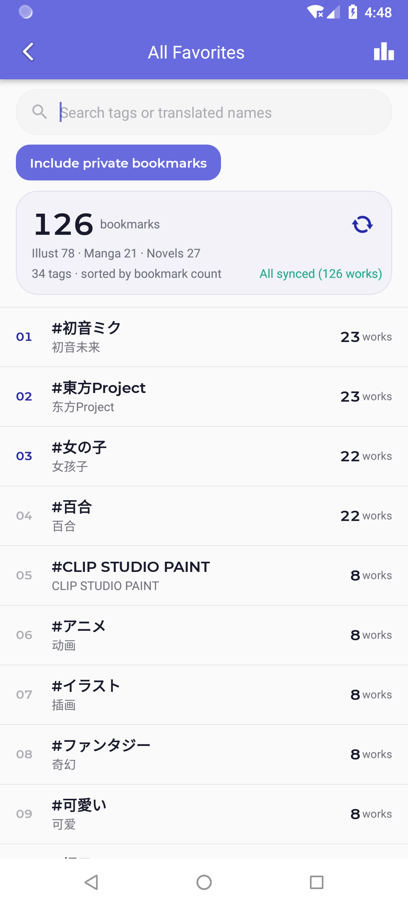</a>
</p>

图中演示账号共有 126 件收藏、34 个标签；例如「初音ミク」命中 23 件作品。实际使用时会显示你当前账号与同步范围的数据。

## 2. 同步和刷新：收藏逐步到齐，已经到齐的先用

### 第一次打开会发生什么

全收藏页面接入原版本地收藏镜像，将公开 / 非公开、图片作品 / 小说等不同书架汇总起来。应用会逐页读取收藏，页面显示已同步件数、正在同步的书架，以及是否已经全部完成。

收藏量较大时，第一页结果出现不代表已经拿到所有收藏。你可以先浏览已经同步的标签和作品；后台继续补齐后，统计与列表会继续更新，不需要为了显示下一批内容不断手动翻页。

### 遇到不同状态时怎么做

| 页面状态 | 含义与下一步 |
| --- | --- |
| 准备同步 / 正在获取全部收藏 | 正在注册或拉取相应书架。可以先等待首批标签出现。 |
| 已同步 N 件 | 已拿到这些收藏，可以先查找；后续页仍在同步。 |
| 已全部同步 | 当前范围已完成这一轮同步，适合查看完整统计或生成海报。 |
| Pixiv 限流冷却中 | 后台暂缓请求，冷却后继续；不需要连续点击刷新。 |
| 收藏镜像未开启 | 按页面提示进入设置，开启镜像后返回。 |
| 读取失败 | 使用页面的重试入口重新读取。 |

在网页或其他客户端新增收藏后，可以通过**下拉刷新或「立即刷新」**请求更新。这里复用的是原版镜像能力，本次增加的是全收藏范围的接入、状态展示与统一查找入口。

## 3. 两层搜索：先找标签，再找这个标签里的作品

### 第一层：搜索标签目录

在总览顶部输入标签原名或译名。例如输入「初音」找角色分类，输入「原创」找对应的原文标签。你不必记住标签的完整日文写法，已有译名也可以用来定位。

这一层的目的，是从全部收藏中找到一个相关主题。点击结果后，才进入该主题下的作品列表。

### 第二层：搜索标签下的作品

详情页搜索框会在当前标签下，继续匹配作品标题、作者和标签文字（含译名）。多个词用空格分开时，会同时匹配这些条件；纯数字还会按作品 ID 或作者 UID 查找。

例如：先进入「初音ミク」分类，再输入记得的作者名；如果只有作品编号，也可以直接输入编号。列表始终限定在你当前已同步、且符合这个标签范围的收藏中。

### 作品类别也可以一起切换

详情页有 **全部 / 插画 / 漫画 / 小说 / 动图** 五档。插画和动图可分别查看；「全部」会将图片作品与小说混排，小说用整行卡片显示标题、作者、收藏数等信息。

一个角色同时有图片和文字作品时，可以先整体回顾，再切换到小说；想找漫画则选择漫画，不必退回总览重新找一遍标签。

<table>
  <tr><th width="50%">图片作品、关键词与类别入口</th><th width="50%">同一标签下切换为小说</th></tr>
  <tr>
    <td valign="top" align="center"><a href="../docs/images/shaftplus/tag-detail.png">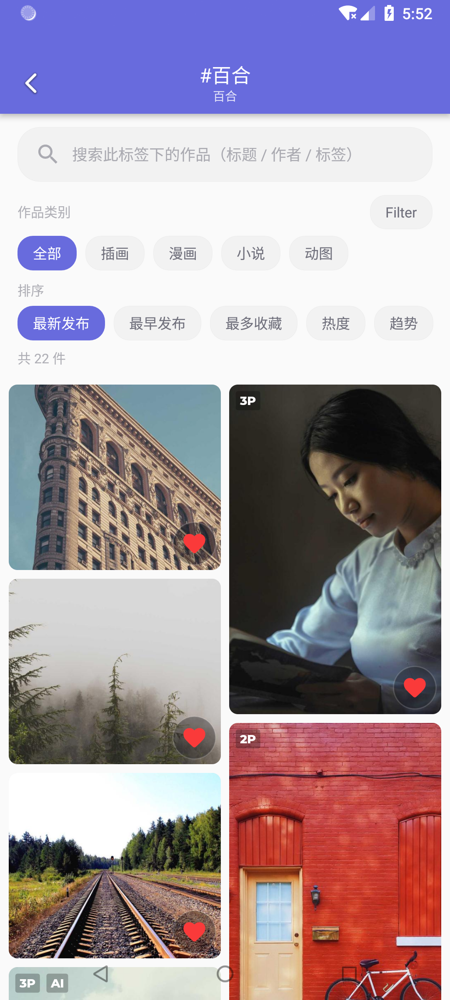</a></td>
    <td valign="top" align="center"><a href="../docs/images/shaftplus/novel-collection.webp">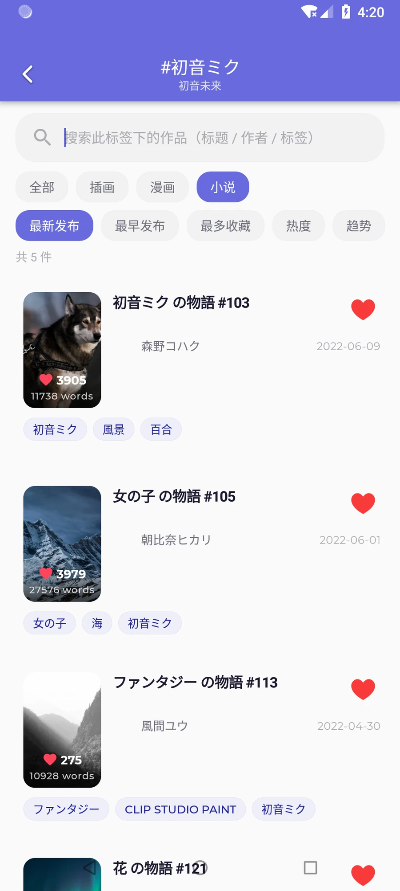</a></td>
  </tr>
</table>

### 没有结果时如何放宽条件

搜索结果会显示「共 N 件」。如果输入的词与当前标签、作品类别或筛选条件组合后没有命中，页面会明确显示无结果。

可以先清空关键词，再检查作品类别和筛选面板，逐步放宽范围。无结果并不表示收藏被删除；例如下图在小说分类输入不存在的文字后，就只剩空态提示。

<p align="center">
  <a href="../docs/images/shaftplus/search-no-results.webp">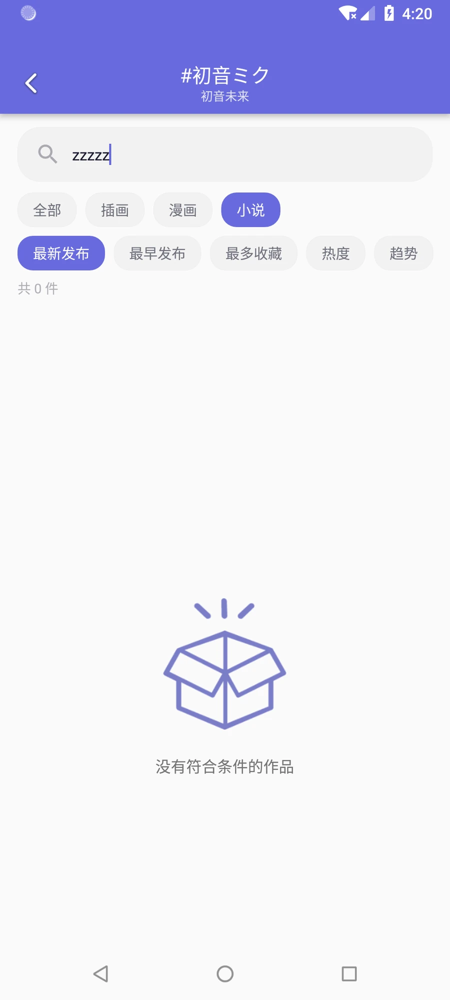</a>
</p>

## 4. 八项筛选：把记不清名字的作品一步步筛出来

搜索适合「还记得几个字」的情况；筛选适合「只记得特征」的情况。例如记得是一篇多页漫画、画面偏竖、不是 AI，就可以先选漫画，再组合页数、比例和 AI 条件。

### 每个条件查的是什么

| 筛选项 | 支持的选择与实际含义 |
| --- | --- |
| 投稿期间 | 最近一周、一月、半年、一年等预设，或自定义起止日期；依据作品投稿时间。 |
| 收藏数 | 使用预设档或自定义区间，如 1000+；依据作品在 Pixiv 的总收藏数。 |
| users入り 标签 | 按作品携带的 `1000users入り` 等标签阈值筛选，与作品当前总收藏数是独立条件。 |
| 长宽比 | 按横图、竖图、正方形图缩小范围。 |
| 分辨率 | 宽高均为 3000px 及以上、1000～2999px，或 999px 及以下；图片尺寸未知的内容不命中具体尺寸档。 |
| 页数 | 区分单页和多页作品，例如只看多页漫画。 |
| AI 作品 | 全部、不显示 AI、仅 AI，依据作品的 AI 标记。 |
| R18 范围 | 全部、仅安全内容、仅 R18，依据作品的限制级信息。 |

这些条件可以同时使用。例如「漫画 + 多页 + 非 AI + 指定投稿日期」会共同限制结果，而不是分别建立四个互不相关的列表。

### 条件如何生效和撤销

选择即更新列表与命中件数，筛选入口会提示当前启用了几项条件。点击「完成」关闭面板；重新打开时，仍能看到当前的选择。

「重置」只清面板里的八项条件，保留搜索框关键词与作品类别。若重置后仍没有结果，可以再检查搜索文字和类别。当前查询条件在旋转或重建页面时也会恢复，避免回到列表后忘记刚才筛选了什么。

<table>
  <tr><th width="50%">完整筛选面板</th><th width="50%">区间选择后回显</th></tr>
  <tr>
    <td valign="top" align="center"><a href="../docs/images/shaftplus/collection-filters.png">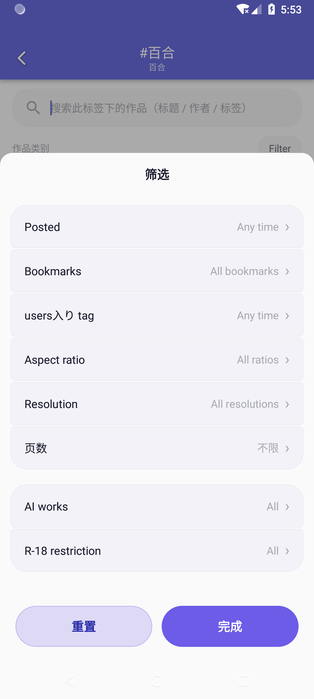</a></td>
    <td valign="top" align="center"><a href="../docs/images/shaftplus/filter-range.webp">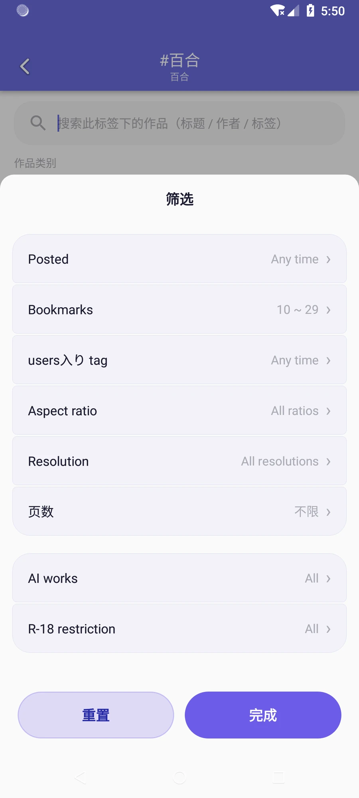</a></td>
  </tr>
</table>

上图的 `10～29` 用来展示已选区间如何回显。下图是另一次筛选演示：入口显示 `Filter · 1`，匹配数从该标签的 22 件缩小到 14 件；它与上面的区间回显不是同一组操作。

<p align="center">
  <a href="../docs/images/shaftplus/filter-applied.webp">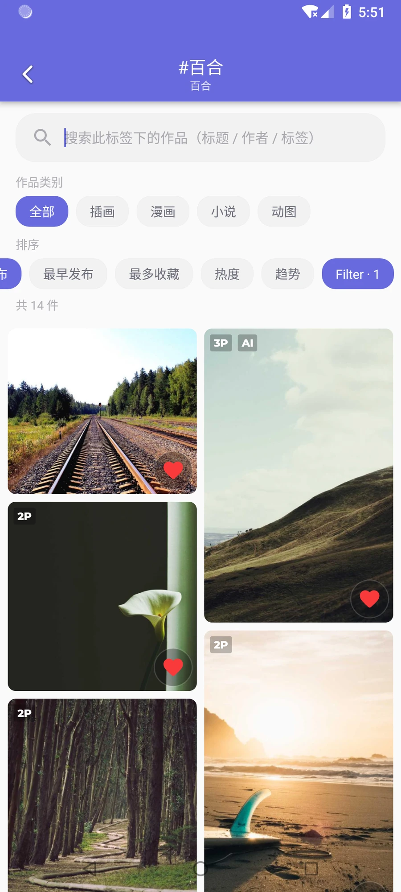</a>
</p>

## 5. 五种排序：同一批收藏，按不同目的回顾

找到一个合适范围后，再决定先看什么。可以先用类别与筛选限定作品，再切换排序；切换排序只改变这批结果的先后，不会撤掉已有条件。

| 页面选项 | 排序依据 | 适合的场景 |
| --- | --- | --- |
| 最新发布 | 作品投稿时间从新到旧 | 先浏览较新的投稿。 |
| 最早发布 | 作品投稿时间从旧到新 | 回顾某个角色或主题的早期作品。 |
| 最多收藏 | Pixiv 总收藏数从多到少 | 优先看这批收藏中被收藏最多的作品。 |
| 热度 | 作品浏览量从多到少 | 从浏览较多的作品开始回顾。 |
| 趋势 | 总收藏数除以发布至今的天数 | 参考平均收藏速率，兼顾投稿时长。 |

这里的「发布」指作者投稿时间，不是你点击收藏的时间。「趋势」是平均速率估算，不代表最近一小时或当天的实时新增收藏数。

例如，想看自己收藏中这个角色的早期漫画，可以先进入角色标签、选择漫画，再点「最早发布」；想回顾其中最受欢迎的作品，则切到「最多收藏」。

## 6. 我的 Tag 排行：从目录统计到可分享的偏好海报

总览里的数字更适合查找，海报则适合回顾和分享。在全收藏分类页打开 **我的 Tag 排行**，应用会将当前范围内命中最多的标签绘成一张完整图片，带有排行、作品件数和总体统计。

它描述的是「我收藏的作品中经常出现什么标签」，因此反映个人偏好；不会把全站热门标签混进来。图中每个标签的件数，来自当前已同步收藏中带这个标签的作品数量。

### TOP 6 与 TOP 20

TOP 6 更适合突出最鲜明的偏好；TOP 20 展开更多主题，适合看收藏构成的细节。切换数量后会重绘预览，随后保存或分享的也是当前选择。

如果收藏中可用标签不够多，实际排行会按已有数量展示。首次同步尚未完成时，海报也只代表已同步部分；希望覆盖全部收藏时，等总览显示同步完成后再生成。

<table>
  <tr><th width="50%">选择 TOP 6 与显示选项</th><th width="50%">切到 TOP 20 预览</th></tr>
  <tr>
    <td valign="top" align="center"><a href="../docs/images/shaftplus/poster-options.webp">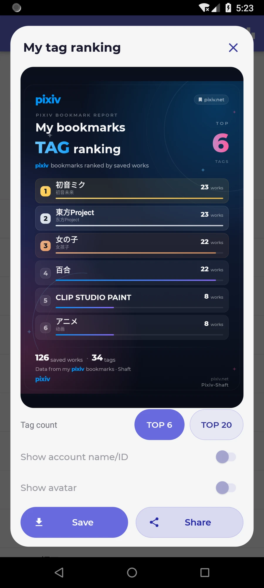</a></td>
    <td valign="top" align="center"><a href="../docs/images/shaftplus/poster-top20-preview.webp">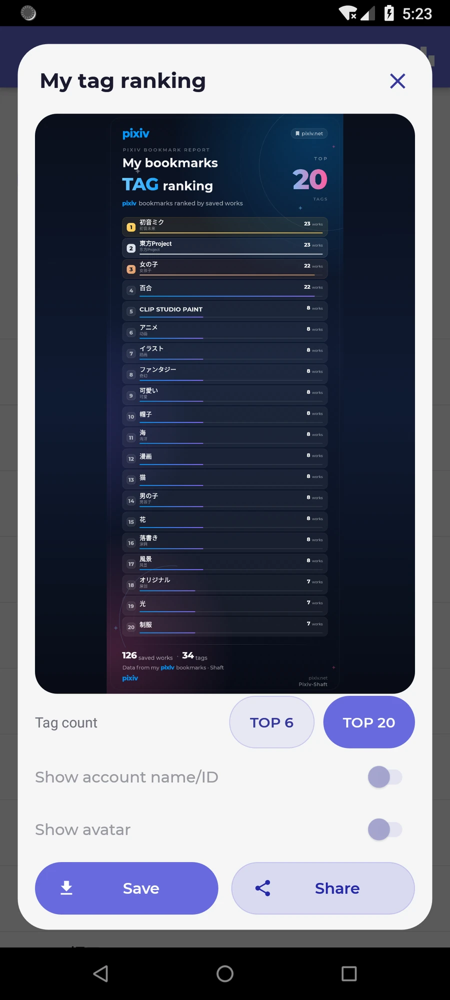</a></td>
  </tr>
</table>

### 账号和头像由你决定

可以独立选择是否显示账号昵称 / ID、是否展示头像。想发一张带个人身份的收藏报告，可以打开对应选项；只想展示标签偏好，也可以隐藏账号信息。

下面三张来自渲染测试，使用虚构账号与示例头像，展示不同组合的输出；这些示例统计与前面的 126 件模拟器收藏不是同一套数据。

<table>
  <tr><th width="33%">显示示例账号</th><th width="33%">显示账号与示例头像</th><th width="33%">隐藏账号信息</th></tr>
  <tr>
    <td valign="top" align="center"><a href="../docs/images/shaftplus/poster-account.webp">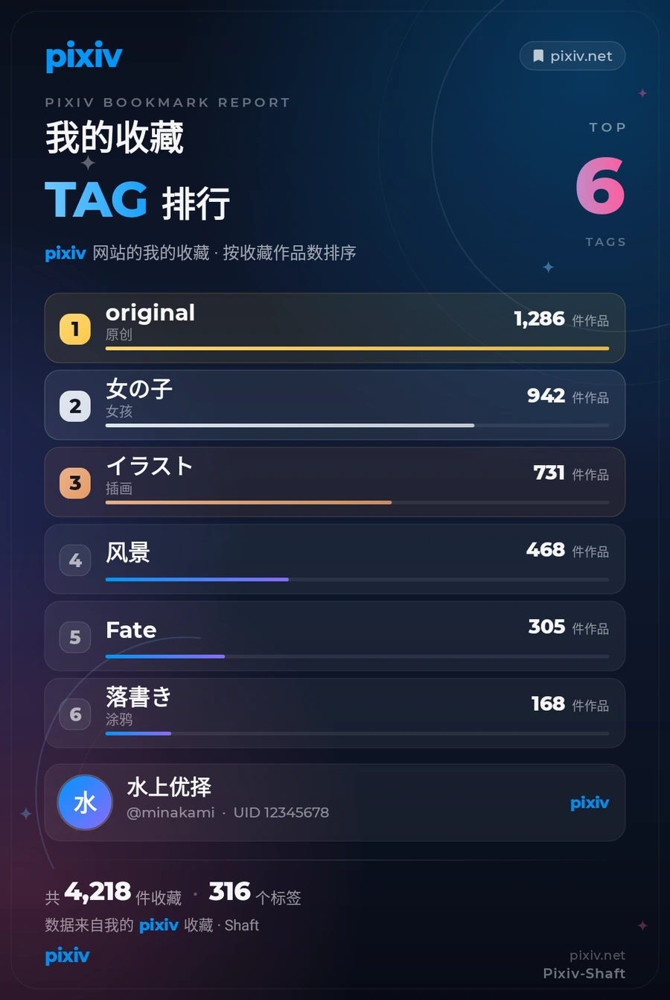</a></td>
    <td valign="top" align="center"><a href="../docs/images/shaftplus/poster-avatar.webp">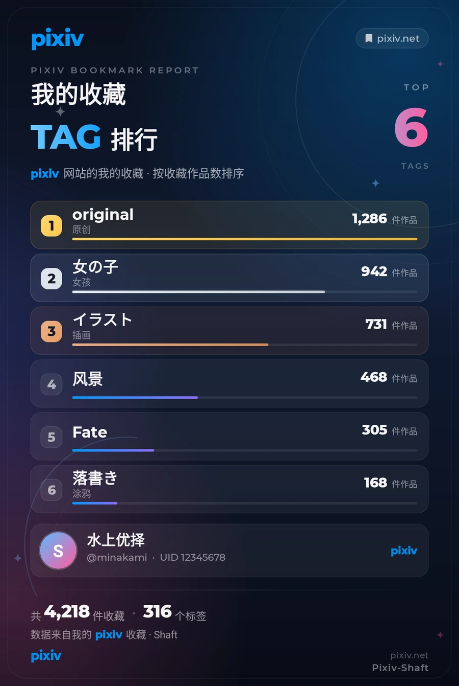</a></td>
    <td valign="top" align="center"><a href="../docs/images/shaftplus/poster-anonymous.webp">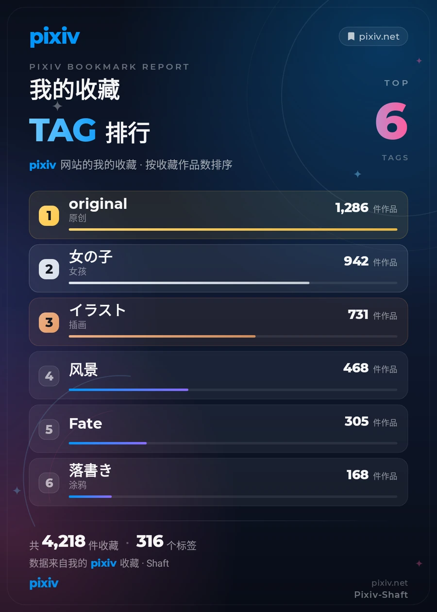</a></td>
  </tr>
</table>

### 保存和分享

点击「保存到相册」会导出图片；点击「分享」会打开系统分享菜单，选择接收图片的应用。导出的是完整海报，而不是把整个弹窗连同开关和按钮截下来。

因此 TOP 20 即使在弹窗里被缩小预览，保存后仍是完整的长图。分享出去前，可以先确认标签数量、收藏范围和个人信息显示选项。

<p align="center">
  <a href="../docs/images/shaftplus/poster-sharing.webp">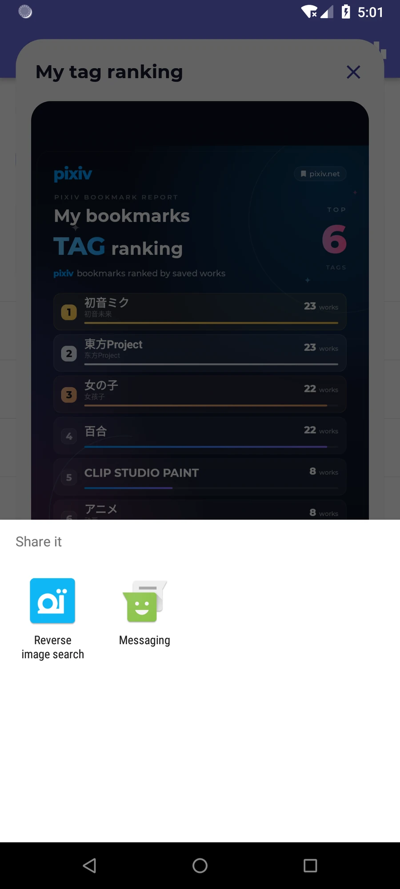</a>
</p>

### 实际导出的海报长什么样

下面是模拟器演示数据导出的 TOP 6 与 TOP 20。两张都可以独立打开查看，保留完整排行、件数、进度条与底部统计。

<table>
  <tr><th width="50%">TOP 6 导出成品</th><th width="50%">TOP 20 导出成品</th></tr>
  <tr>
    <td valign="top" align="center"><a href="../docs/images/shaftplus/tag-ranking-top6.png">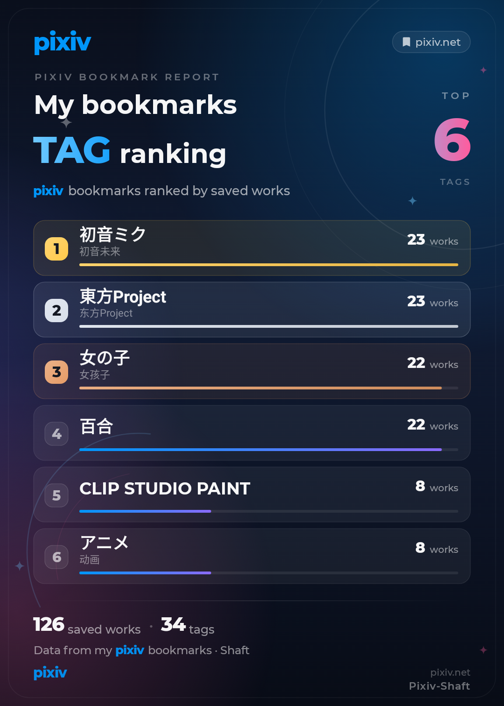</a></td>
    <td valign="top" align="center"><a href="../docs/images/shaftplus/tag-ranking-top20.png">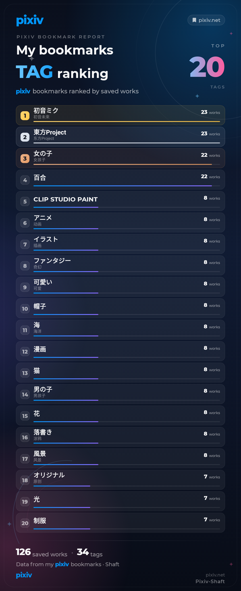</a></td>
  </tr>
</table>

## 7. 原图与预览：需要细节时直接切，不必先找设置

经典详情页与 V3 详情页新增常驻的 **查看原图 / 返回预览** 按钮。平时先用预览图浏览，发现线条、文字或画面细节需要看清时，在当前页面切到完整分辨率图；看完也可以切回预览。

### 与原来的设置怎样配合

详情页按钮和「详情页直接加载原图」使用同一份偏好。你在详情页切换后，设置页会跟随；在设置里改动后返回详情页，也会按新选择加载。

应用会记住这个选择，翻到相邻作品或以后再次打开详情时继续生效。它不是只对当前一次按钮点击临时换一张图。

### 多页作品和平板的处理

多页作品切换清晰度时会保留当前页，避免正在看中间某一页时又被带回第一页。平板作品区也跟随清晰度变化重新加载。

动图和本地快照不显示不适用的原图切换入口。下面是操作关系示意，不是界面截图：

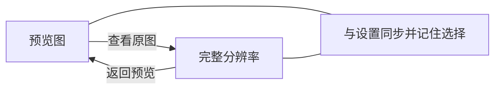

例如，浏览一组漫画时先用预览快速翻页，到某页看不清文字，再点「查看原图」。这个入口改变的是详情页加载清晰度；原图文件较大时，实际加载速度仍取决于网络和图片体积。

## 8. 小说翻译：底栏入口、进度、续翻和显示方式连起来

小说全文翻译能力沿用原版，本次把它接到了阅读器底栏，让你在阅读过程中直接进入，而不用反复打开顶部菜单查找。同一个按钮会根据当前状态显示不同的文字。

| 当前状态 | 按钮显示 | 点击后可以做什么 |
| --- | --- | --- |
| 还未翻译 | 翻译 | 开始全文翻译。 |
| 正在处理 | 翻译中 xx% | 查看已完成的段数；重复点击不会再启动一份任务。 |
| 翻译中断 | 继续翻译 | 续翻，也可选择已有译文的显示方式。 |
| 已有译文 | 译文 | 选择仅原文、仅译文或双语对照。 |

### 三种显示方式适合什么情况

- **仅原文**：回到原文阅读，核对字句或专有名词。
- **仅译文**：以译文为主连贯阅读。
- **双语对照**：同时保留原文与译文，方便逐段对照理解。

长篇翻译中断后，可以从底栏继续；已有译文也可以先查看。翻译服务、语言选择及排版系统继续使用原版实现，本次新增的是可见入口、百分比进度和状态联动。

下面是状态流程示意：

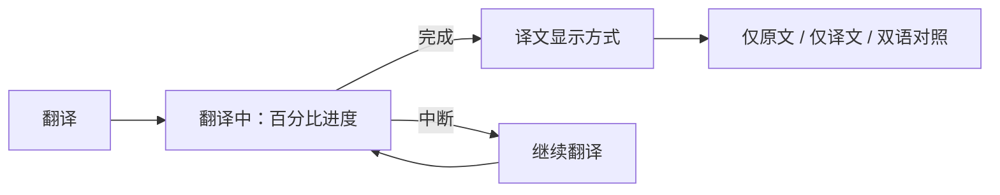

## 9. 三个常见用法

### 找回某个角色的漫画

先在总览搜索角色标签，进入后选择「漫画」。还记得作者或标题片段就继续搜索；只记得是多页作品，就在筛选面板选择多页。最后可以按最新、最早或最多收藏排序浏览。

### 回顾某个主题下的小说

进入题材标签后切到「小说」，用整行卡片查看标题和作者。记得投稿大致年份时，再限定日期范围。点开目标小说后，可从阅读器底栏使用翻译入口；需要核对原文时切成双语对照。

### 做一张自己的收藏偏好报告

先决定是否包含非公开收藏，等待相应范围同步完成，再打开「我的 Tag 排行」。选择 TOP 6 或 TOP 20，检查账号和头像选项，预览确认后保存或分享。

## 10. 常见问题

### 这里能替我手工建文件夹、改标签吗？

当前增加的是按作品已有标签汇总和检索的入口，不是手工移动收藏或批量改写标签的工具。你可以换多个查看角度找作品，但不会因此改变 Pixiv 上作品标签和收藏的公开状态。

### 为什么收藏总数或标签排行还在增加？

通常是首次同步还没结束。页面会先展示已经拿到的数据，再随后台同步继续补齐。看完整统计或生成覆盖全部收藏的海报时，等页面显示完成状态。

### 关闭非公开收藏会删除它们吗？

不会。这个开关控制当前页面与海报的统计范围，不会取消收藏或修改公开状态。

### 为什么作品明明收藏了，当前列表却找不到？

先确认同步范围和进度，再检查当前标签、作品类别、关键词与筛选条件。详情页查找限定在当前标签中；条件过多时可以先重置面板，再清空搜索和切回全部类别。

### 为什么「最早发布」不是我最早收藏的作品？

排序用作者投稿时间。不同收藏书架的收藏序号不能直接作为统一时间比较，所以本页没有将它标成「收藏时间」。

### 收藏数、热度、趋势为什么不一样？

收藏数看作品总收藏量；热度看浏览量；趋势按总收藏数与发布天数估算平均收藏速率。它们适合不同目的，不是同一份分数换三个名字。

### 海报里的数字为什么加起来超过收藏数？

一个作品可以同时带有多个标签，会分别计入相应标签。例如同时带角色与题材标签的同一作品，两个分类都能查到它。

### 没有图像尺寸的小说会出现在分辨率筛选里吗？

具体分辨率条件用于有已知宽高的图片。小说或尺寸未知的内容不会因为宽高为零就被误算成小尺寸图片。

### 原版、旧 debug 包的数据会自动带过来吗？

这个正式包使用独立包名和签名，可以与原版并存；原版或旧 debug 包的应用数据不会自动迁移。登录自己的 Pixiv 账号后，在本包内同步收藏。

## 安装与验证

- Android 7.0（API 24）及以上，当前提供 `arm64-v8a` APK。
- 显示名：**shaft+**；正式包名：`ceui.pixiv.shaftplus`。
- 版本：`4.9.7.1`（versionCode `43301`），使用本项目专属 release 签名。
- 后续更新使用本仓库 Releases 中相同签名的 APK，应用内更新目标也指向本 fork。

本次功能、更新和图像手势相关的 **153 项 JVM / Robolectric 定向回归通过**；正式 APK 经 release 构建、R8、lintVital、包身份、签名与对齐检查。完整测试不宣称全部通过，具体范围见 Release 说明。真实账号全量同步、原图加载和翻译结果仍需登录回归。

## 来源与许可

shaft+ 基于 [CeuiLiSA/Pixiv-Shaft](https://github.com/CeuiLiSA/Pixiv-Shaft) 的 classic 分支。原作者、贡献者及版权声明保留在源码与 Git 历史中，沿用 **GPL-2.0**，完整条款见 [LICENSE](../LICENSE)。发布 APK 时提供对应源码。

本项目与 Pixiv、PixShaft 及原版维护者无隶属或合作关系。作品版权归各自作者或 Pixiv；相关名称、标志与服务归各自权利人所有。

可选 PixShaft 托管功能保留原有入口，可用性受运营方政策限制；本分支不含上游签名私钥或 events HMAC 密钥，已移除上游 Firebase Analytics / Crashlytics SDK 与配置。

## 构建与发布

使用 JDK 17、Android SDK 36、NDK `27.0.12077973`、CMake `3.22.1` 和项目自带 Gradle Wrapper：

```sh
./gradlew :app:assembleGithubDebug
```

正式包需要自行配置 `keystore.properties` 或 `SHAFT_KEYSTORE_*` 环境变量。密钥和密码不提交。完整步骤见[构建与发布说明](../docs/shaft-plus-publishing.md)。
